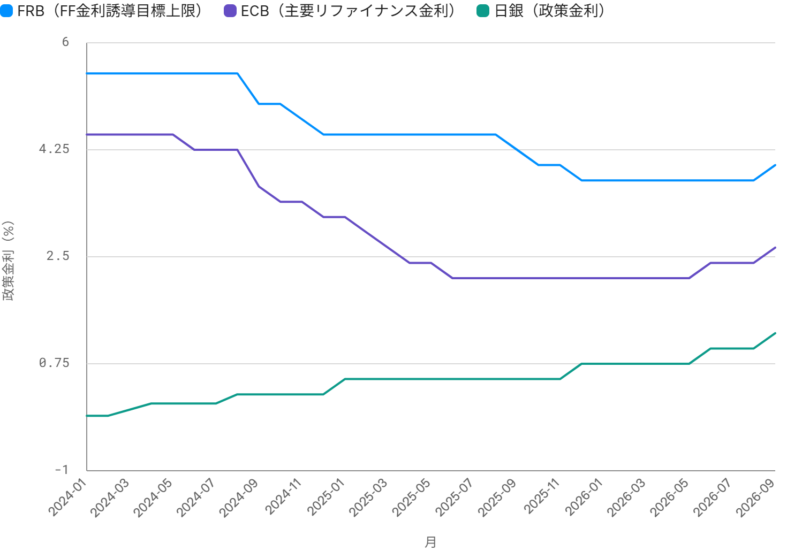

<!--
id: RX-USECASE-0093
type: use-case
language: zh-hk
locale: zh-hk
author: Reflexivity GTM Team
source_type: partner-provided-use-case
provider: QUICK
source_manifest: RX-USECASE-0093
source_created: 2026-10-28
published: 2026-11-17
revised: 2026-11-17
editorial_reviewed: 2026-11-17
resource: QUICK-provided Reflexivity research workflow
status: published
translation_status: current
prompt_status: present
prompt_basis: faithful-translation
-->

# 比較美歐日央行政策與法國國債風險

<!-- locale-switcher:start -->
**語言:** [English](../../../../en/05-use-cases/03-asset-class/03-macro/compare-fed-ecb-and-boj-policy-stances-and-french-bond-risks.md) · [日本語](../../../../ja/05-ユースケース/03-運用資産別/03-マクロ/FRB・ECB・日銀の政策スタンスとフランス国債を比較する.md) · [한국어](../../../../ko/05-유스케이스/03-운용자산별/03-매크로/FRB·ECB·BOJ-정책과-프랑스-국채-리스크-비교.md) · [简体中文](../../../../zh-cn/05-使用案例/03-按资产类别/03-宏观/比较美欧日央行政策与法国国债风险.md) · [繁體中文（臺灣）](../../../../zh-tw/05-使用案例/03-依資產類別/03-總體/比較美歐日央行政策與法國國債風險.md) · **繁體中文（香港）**
<!-- locale-switcher:end -->

[← Use Cases](../../README.md)

**QUICK | 2026-10-28**

## 使用的提示詞

> [!IMPORTANT]
> 總結聯儲局、歐洲央行及日本銀行的政策立場及加息或減息可能性。

## 研究流程

比較 2026 年 10 月 28 日聯儲局、歐洲央行及日本銀行的政策取向，並延伸至法國國債信用及息差風險。

## 當時的案例

案例明確區分聯儲局政策利率區間、ECB 存款便利利率及日本隔夜拆借利率目標，並討論能源通脹壓力。

## 解讀與限制

這是會議前的歷史情境，並非現時利率表。比較時須區分政策工具定義、日期、市場預期及實際決策。

## 相關功能

- [Alfred](https://github.com/reflexivity-kb/platform/blob/main/zh-hk/03-%E7%94%A2%E5%93%81/Alfred.md)

產品手冊可能需要獲授權才能查閱。

## 研究畫面與圖表

以下為提供當時的原始研究畫面與圖表，並非現時市場數據。

## 提供者

本案例由 QUICK 提供，所列數據及判斷均屬當時研究快照，並非當前預測。

[← Use Cases](../../README.md)
