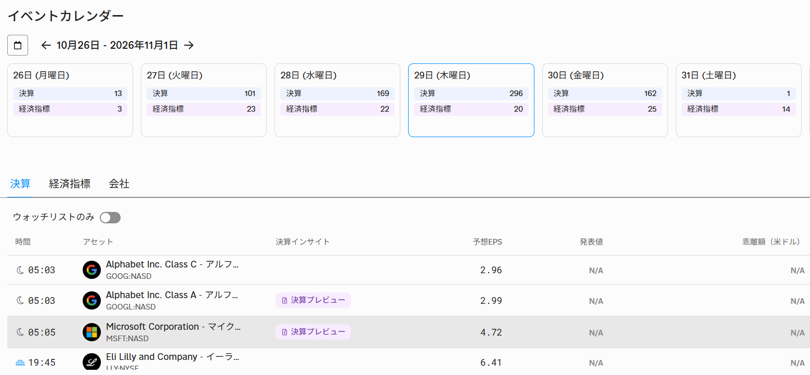

<!--
id: RX-USECASE-0104
type: use-case
language: zh-hk
locale: zh-hk
author: Reflexivity GTM Team
source_type: partner-provided-use-case
provider: QUICK
source_manifest: RX-USECASE-0104
source_created: 2026-11-16
published: 2026-11-17
revised: 2026-11-17
editorial_reviewed: 2026-11-17
resource: QUICK Reflexivity theme-company workflow
status: published
translation_status: current
prompt_status: not_provided
-->

# 從防務無人機主題篩選相關上市企業

<!-- locale-switcher:start -->
**語言:** [English](../../../../en/05-use-cases/03-asset-class/04-equities/defense-drone-theme-to-listed-company-screener.md) · [日本語](../../../../ja/05-ユースケース/03-運用資産別/04-株式/防衛用ドローンのテーマから関連上場企業を探す.md) · [한국어](../../../../ko/05-유스케이스/03-운용자산별/04-주식/방위용-드론-테마에서-관련-상장기업-찾기.md) · [简体中文](../../../../zh-cn/05-使用案例/03-按资产类别/04-股票/从防务无人机主题筛选相关上市企业.md) · [繁體中文（臺灣）](../../../../zh-tw/05-使用案例/03-依資產類別/04-股票/從防務無人機主題篩選相關上市企業.md) · **繁體中文（香港）**
<!-- locale-switcher:end -->

[← Use Cases](../../README.md)

**2026-11-16**
## 使用的提示詞

提供資料中未列明實際使用的提示詞全文。

## 操作流程

2026 年 11 月 16 日提到的 Saronic Technologies 是尚未上市的初創企業。與其將新聞中的企業當作可直接買賣的股票，可先從防務無人機主題尋找相關上市企業。

## 應用價值

在搜尋欄輸入日文 `防衛`，開啟「防務無人機」主題及企業名單，再查看主題表現與個股概覽。透過資產連動功能把企業加入觀察名單，或利用股票篩選器收窄候選範圍。

## 注意事項

與主題有關不代表企業已上市、具備充足流動性或相關收入佔比高。投資前應另外核實上市狀態、業務關聯及財務指標。

## 相關功能

- [Search](https://github.com/reflexivity-kb/platform/blob/main/zh-hk/03-%E7%94%A2%E5%93%81/%E6%90%9C%E5%B0%8B.md)
- [Themes](https://github.com/reflexivity-kb/platform/blob/main/zh-hk/03-%E7%94%A2%E5%93%81/%E6%8A%95%E8%B3%87%E4%B8%BB%E9%A1%8C.md)
- [Screener](https://github.com/reflexivity-kb/platform/blob/main/zh-hk/03-%E7%94%A2%E5%93%81/%E8%82%A1%E7%A5%A8%E7%AF%A9%E9%81%B8%E5%99%A8.md)
- [Watchlist](https://github.com/reflexivity-kb/platform/blob/main/zh-hk/03-%E7%94%A2%E5%93%81/%E8%A7%80%E5%AF%9F%E5%90%8D%E5%96%AE.md)

相關產品手冊可能需要授權才能查閱。

## 防務無人機主題操作截圖

兩幅截圖展示 2026 年 11 月 16 日從「防務無人機」主題進入相關企業、表現分析以及監察名單或篩選器的操作流程。

*本使用案例由我們在日本的合作夥伴 QUICK 惠予提供。* · [免責聲明](../../DISCLAIMER.md)

[← Use Cases](../../README.md)
