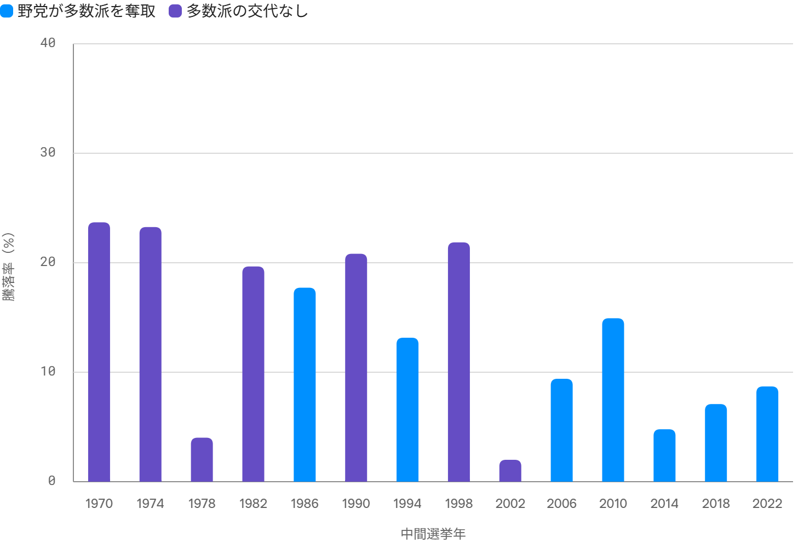

<!--
id: RX-USECASE-0105
type: use-case
language: zh-hk
locale: zh-hk
author: Reflexivity GTM Team
provider: 株式会社QUICK
source_created: 2026-11-02
published: 2026-11-17
revised: 2026-11-17
editorial_reviewed: 2026-11-17
resource: QUICK Reflexivity usage example: Study six-month S&P 500 returns after US midterm elections
status: published
translation_status: current
publication_mode: faithful-source-preserving
prompt_status: present
prompt_basis: source-verbatim
-->

# 檢驗美國中期選舉後六個月標普 500 回報

<!-- locale-switcher:start -->
**Languages:** [English](../../../../en/05-use-cases/03-asset-class/04-equities/study-six-month-s-p-500-returns-after-us-midterm-elections.md) · [日本語](../../../../ja/05-ユースケース/03-運用資産別/04-株式/米中間選挙後6か月のS&P500を長期比較する.md) · [한국어](../../../../ko/05-유스케이스/03-운용자산별/04-주식/미국-중간선거-후-6개월-S&P500-수익률-검증.md) · [简体中文](../../../../zh-cn/05-使用案例/03-按资产类别/04-股票/检验美国中期选举后六个月标普-500-回报.md) · [繁體中文（臺灣）](../../../../zh-tw/05-使用案例/03-依資產類別/04-股票/檢驗美國中期選舉後六個月標普-500-回報.md) · **繁體中文（香港）**
<!-- locale-switcher:end -->

[← 使用案例](../../README.md)

**案例日期:** 2026-11-02  
**主要使用功能:** Alfred

統計 1970 年以來選舉後六個月的回報，並比較反對黨奪得多數議席的情況。

> [!NOTE]
> 數字、預測及介面只反映案例所述日期的研究情況，並非即時市場資料。

## 使用的提示詞

> [!IMPORTANT]
> 米国中間選挙の６か月後のS&P500の数値は中間選挙前と比べてパフォーマンスがどうなっているのかを1970年以降から現在までを分析してください。また、政権を取っていない側の政党が勝利した場合と、政権側がそのまま多数議席を獲得した場合とで違いがあるかも調べてください。

示範以日語提問。以上保留原始措辭，以避免遺漏條件及時間範圍。

## 研究目的及操作流程

1. 統計 1970 年以來選舉後六個月的回報，並比較反對黨奪得多數議席的情況。
2. 不要只看摘要，還應核對相關企業、主題、事件及市場資料。
3. 形成當前投資結論前，確認觀察區間、指標定義及其他可能原因。

## 案例展示的分析結果

統計 1970 年以來選舉後六個月的回報，並比較反對黨奪得多數議席的情況。

1970–2022 年 14 次中期選舉後六個月標普 500 平均 +13.65%、中位數 +14.04%。

## 產品畫面及分析圖表

## 閱讀時的注意事項

數字、預測及介面只反映案例所述日期的研究情況，並非即時市場資料。

## 相關產品功能

- [Alfred](https://github.com/reflexivity-kb/platform/blob/main/zh-hk/03-%E7%94%A2%E5%93%81/Alfred.md)

查看連結的產品手冊可能需要存取權限。

---

本案例由 QUICK 提供。市場數字及情景判斷僅代表當時的分析。

[← 使用案例](../../README.md)
