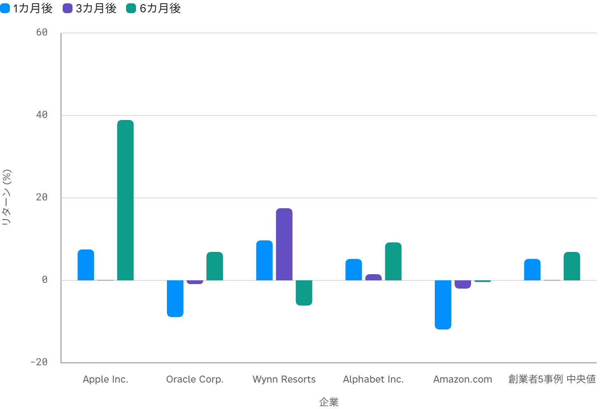

<!--
id: RX-USECASE-0092
type: use-case
language: zh-hk
locale: zh-hk
author: Reflexivity GTM Team
provider: 株式会社QUICK
source_created: 2026-11-13
published: 2026-11-17
revised: 2026-11-17
editorial_reviewed: 2026-11-17
resource: QUICK Reflexivity usage example: Compare founder-CEO departures and subsequent stock performance
status: published
translation_status: current
publication_mode: faithful-source-preserving
prompt_status: present
prompt_basis: source-verbatim
-->

# 比較創辦人 CEO 辭任後的股價及行業影響

<!-- locale-switcher:start -->
**Languages:** [English](../../../../en/05-use-cases/03-asset-class/04-equities/compare-founder-ceo-departures-and-subsequent-stock-performance.md) · [日本語](../../../../ja/05-ユースケース/03-運用資産別/04-株式/創業者CEO辞任後の株価と業界波及を比較する.md) · [한국어](../../../../ko/05-유스케이스/03-운용자산별/04-주식/창업자-CEO-사임-이후-주가와-업계-영향-비교.md) · [简体中文](../../../../zh-cn/05-使用案例/03-按资产类别/04-股票/比较创始人-CEO-辞任后的股价与行业影响.md) · [繁體中文（臺灣）](../../../../zh-tw/05-使用案例/03-依資產類別/04-股票/比較創辦人-CEO-辭任後的股價及行業影響.md) · **繁體中文（香港）**
<!-- locale-switcher:end -->

[← 使用案例](../../README.md)

**案例日期:** 2026-11-13  
**主要使用功能:** Alfred

將 NVIDIA 管理層更替與歷史創辦人離任案例比較，觀察 1、3、6 個月股價及 AI 行業影響。

> [!NOTE]
> 數字、預測及介面只反映案例所述日期的研究情況，並非即時市場資料。

## 使用的提示詞

> [!IMPORTANT]
> NVIDIAのジェイスン・ファンCEOが辞任しました。過去20年間でこのように時価総額の大きな会社で創業者が突然辞任するようなケースがあったかを調べてください。その際の１か月後、３か月後、６か月後の株価のパフォーマンスも分析してください。 また、今回のファンCEOの辞任で、AIやデータセンターの業界に与える影響がどの程度と市場は見ていますでしょうか？

示範以日語提問。以上保留原始措辭，以避免遺漏條件及時間範圍。

## 研究目的及操作流程

1. 將 NVIDIA 管理層更替與歷史創辦人離任案例比較，觀察 1、3、6 個月股價及 AI 行業影響。
2. 不要只看摘要，還應核對相關企業、主題、事件及市場資料。
3. 形成當前投資結論前，確認觀察區間、指標定義及其他可能原因。

## 案例展示的分析結果

將 NVIDIA 管理層更替與歷史創辦人離任案例比較，觀察 1、3、6 個月股價及 AI 行業影響。

透過五個創辦人交接案例，分別討論 NVIDIA 短期股價及 AI 行業中期影響。

- [相關官方披露](https://nvidianews.nvidia.com/news/nvidia-announces-ceo-transition)

## 產品畫面及分析圖表

## 閱讀時的注意事項

數字、預測及介面只反映案例所述日期的研究情況，並非即時市場資料。

## 相關產品功能

- [Alfred](https://github.com/reflexivity-kb/platform/blob/main/zh-hk/03-%E7%94%A2%E5%93%81/Alfred.md)

查看連結的產品手冊可能需要存取權限。

---

本案例由 QUICK 提供。市場數字及情景判斷僅代表當時的分析。

[← 使用案例](../../README.md)
