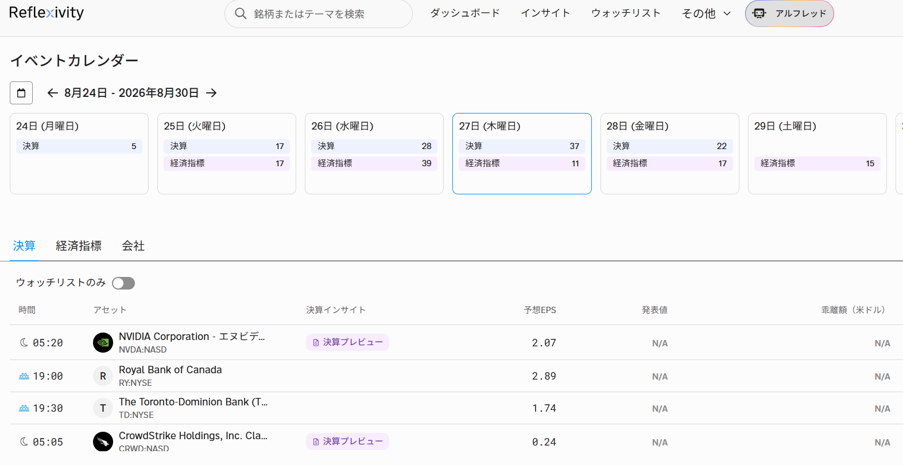
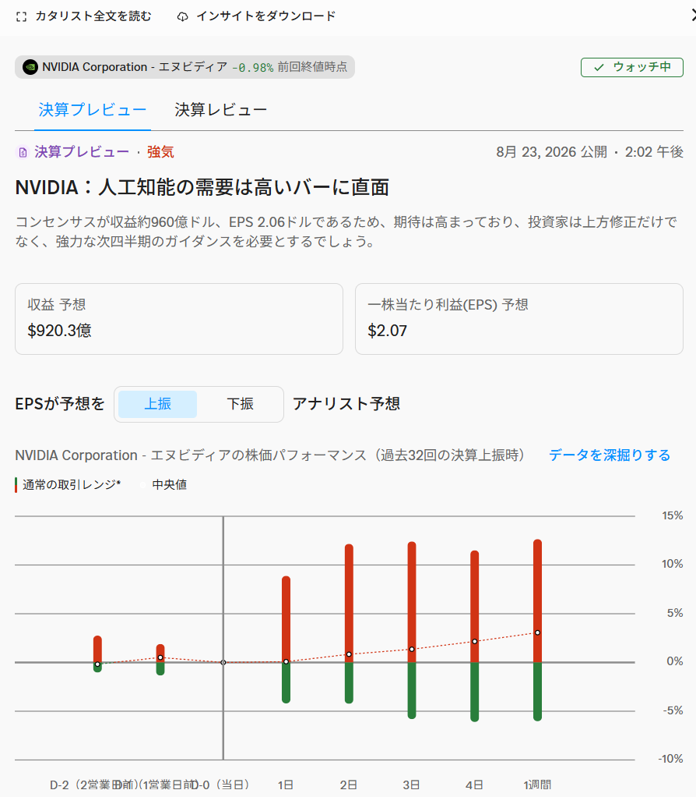
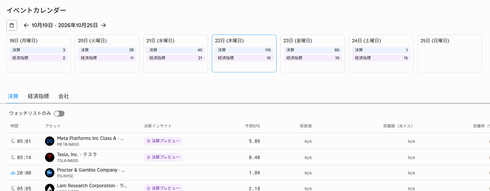

<!--
id: RX-USECASE-0071
type: use-case
language: zh
locale: zh-HK
provider: QUICK Inc.
source_created: 2026-09-30
provided: 2026-09-30
status: published
translation_status: current
editorial_reviewed: 2026-10-03
source_type: partner-provided-use-case
source_manifest: RX-USECASE-0071
asset_class: Equities
insight_type: Earnings Catalyst
publication_mode: faithful-source-preserving
prompt_status: not_provided
-->
# 用 Earnings Preview 為 Micron 業績做準備

<!-- locale-switcher:start -->
**Languages:** [English](../../../../en/05-use-cases/03-asset-class/04-equities/micron-earnings-preview-workflow.md) · [日本語](../../../../ja/05-ユースケース/03-運用資産別/04-株式/マイクロン決算プレビュー.md) · [한국어](../../../../ko/05-유스케이스/03-운용자산별/04-주식/마이크론-실적-프리뷰.md) · [简体中文](../../../../zh-cn/05-使用案例/03-按资产类别/04-股票/美光财报预览.md) · [繁體中文（台灣）](../../../../zh-tw/05-使用案例/03-依資產類別/04-股票/美光財報預覽.md) · **繁體中文（香港）**
<!-- locale-switcher:end -->

[← 股票使用案例](README.md) · [按資產類別](../README.md) · [全部使用案例](../../README.md)

**提供日期：** 2026-09-30  
**主要資產：** 股票

> 本案例製作於 Micron 業績發布前，應視為歷史性的業績前研究流程。

QUICK 的案例示範如何在業績發布前先整理檢查點，而不是等發布後才開始閱讀。

> ### [在 Reflexivity 開啟此洞察 →](https://app.reflexivity.com/kg-insight?insightId=b6a73f02-a2ab-401e-a1c0-4e222a9f99cd)

## 發布前

從 **Other → Events** 查看業績日程，開啟 **Earnings Preview** 後可看到市場共識、主要指標及重點。

提供畫面以 **AI 需求**為 Micron 業績預覽主線。事件日曆顯示預期 EPS **31.5**；Earnings Preview 指標面板顯示預期收入 **511.3億美元（約 $51.13B）**、預期 EPS **$31.5**。Top 5 畫面亦提到 Q3 收入 **$41.5B**、EPS **$25.11**，Q4 收入指引 **$50B ± $1B**、毛利率約 **86%**、EPS **$31 ± $1**，以及供應緊張、資本開支與 HBM 需求。

## 發布後

業績發布後，流程進入 **Earnings Review**，把實際結果與事前共識及重點比較。

## 使用價值

1. **Preview：** 先整理日程、共識及核心問題。
2. **Review：** 發布後檢查哪些內容與預期不同。

這樣可以把業績事件變成發布前後連續的研究流程，而不是一次性的新聞查看。

## 補充業績預覽：NVIDIA 與 Events

2026 年 8 月 25 日 NVIDIA 案例從 **Events** 確認公布日，利用 **Earnings Preview** 查看收入、EPS 市場預測及關鍵 KPI，再由完整 Catalyst 分析尋找關聯主題。10 月 20 日案例亦示範從 **Asset Overview** 或整體 **Events 日曆**進入相同流程。公布後再用 Review 核對事前問題。所有時間及預期值均屬歷史快照。

## 來源

本頁基於 QUICK 於 2026-09-30 提供的 Reflexivity 使用案例，只包括郵件及截圖中可確認的資訊。

## 補充截圖：NVIDIA 業績及公司日曆

2026 年 8 月 25 日的 NVIDIA 例子從業績日期查看市場預期和相關催化劑。10 月 20 日的介面展示個股概覽中的業績日期及 Events 日曆，銜接公布前的預覽和公布後的回顧。

## 相關產品功能

- [事件日曆（業績時間表）](https://github.com/reflexivity-kb/platform/blob/main/zh-hk/03-%E7%94%A2%E5%93%81/%E4%BA%8B%E4%BB%B6%E6%97%A5%E6%9B%86.md)
- [研究洞察（業績預覽）](https://github.com/reflexivity-kb/platform/blob/main/zh-hk/03-%E7%94%A2%E5%93%81/%E7%A0%94%E7%A9%B6%E6%B4%9E%E5%AF%9F.md)

查閱產品手冊可能需要存取權限。

*本使用案例由我們在日本的合作夥伴 QUICK 惠予提供。* · [免責聲明](../../DISCLAIMER.md)

[← 股票使用案例](README.md) · [全部使用案例](../../README.md)
