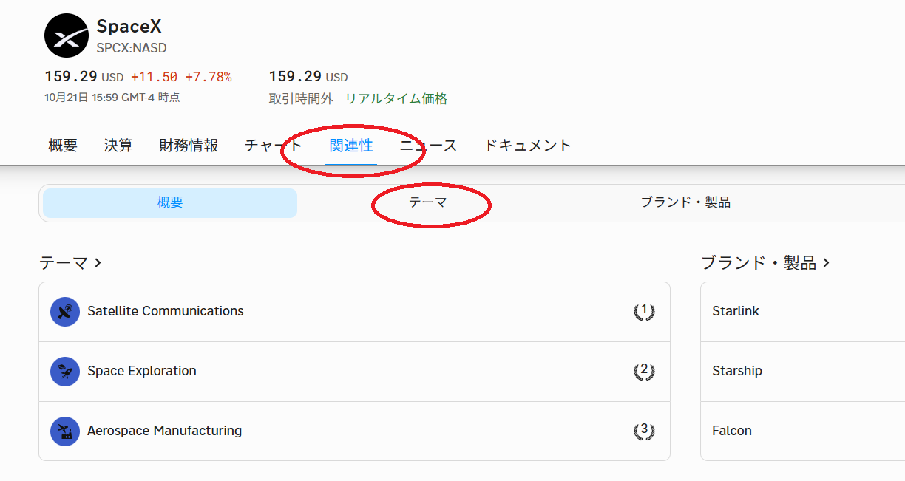

<!--
id: RX-USECASE-0090
type: use-case
language: zh-hk
locale: zh-hk
author: Reflexivity GTM Team
source_type: partner-provided-use-case
provider: QUICK
source_manifest: RX-USECASE-0090
source_created: 2026-10-22
published: 2026-11-17
revised: 2026-11-17
editorial_reviewed: 2026-11-17
resource: QUICK provided Reflexivity workflow
status: published
translation_status: current
prompt_status: not_provided
-->

# 透過關聯主題跨行業研究 SpaceX

<!-- locale-switcher:start -->
**語言:** [English](../../../../en/05-use-cases/03-asset-class/04-equities/use-related-themes-to-understand-spacex-across-industries.md) · [日本語](../../../../ja/05-ユースケース/03-運用資産別/04-株式/SpaceXを関連テーマから複数の業種横断で調べる.md) · [한국어](../../../../ko/05-유스케이스/03-운용자산별/04-주식/SpaceX의-관련-테마로-산업-간-연결을-살펴보기.md) · [简体中文](../../../../zh-cn/05-使用案例/03-按资产类别/04-股票/通过关联主题跨行业研究-SpaceX.md) · [繁體中文（臺灣）](../../../../zh-tw/05-使用案例/03-依資產類別/04-股票/透過關聯主題跨產業研究-SpaceX.md) · **繁體中文（香港）**
<!-- locale-switcher:end -->

[← Use Cases](../../README.md)

**QUICK | 2026-10-22**

## 使用的提示詞

提供資料中未列明實際使用的提示詞全文。

## 研究流程

不能只以單一行業標籤理解 SpaceX。可從個股概覽的「關聯」進入主題，再查看業績摘要以理解多種業務聯繫。

## 當時的分析結果

2026 年 10 月 22 日的畫面案例顯示前三項為航天主題、第四、第六、第七項與 AI 有關，並繼續進入業績摘要。

## 解讀與限制

主題排名表達關係而非收入佔比、持倉權重或股價回報。業務數據應以公司披露為準，介面與涵蓋範圍亦可能改變。

## 相關產品功能

- [Asset Overview](https://github.com/reflexivity-kb/platform/blob/main/zh-hk/03-%E7%94%A2%E5%93%81/%E5%80%8B%E8%82%A1%E6%A6%82%E8%A6%BD.md)
- [Themes](https://github.com/reflexivity-kb/platform/blob/main/zh-hk/03-%E7%94%A2%E5%93%81/%E6%8A%95%E8%B3%87%E4%B8%BB%E9%A1%8C.md)
- [Insights](https://github.com/reflexivity-kb/platform/blob/main/zh-hk/03-%E7%94%A2%E5%93%81/%E7%A0%94%E7%A9%B6%E6%B4%9E%E5%AF%9F.md)

產品手冊可能需要獲授權才能查閱。

## 研究畫面與圖表

以下為提供當時的原始研究畫面與圖表，並非現時市場數據。

## 提供者

本內容由 QUICK 提供。

視乎國家或地區、語言環境、使用產品、權限及數據涵蓋範圍，未必可以完全按本文方式重現本案例。

[← Use Cases](../../README.md)
