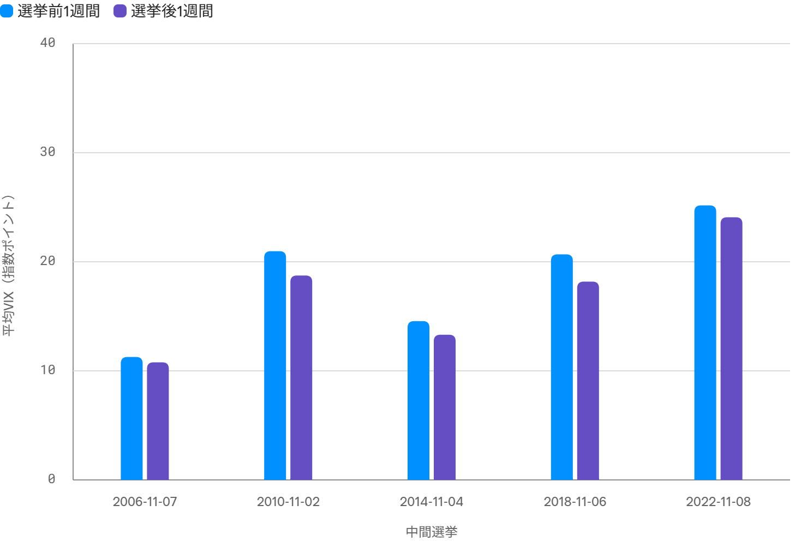

<!--
id: RX-USECASE-0104
type: use-case
language: zh-hk
locale: zh-hk
author: Reflexivity GTM Team
provider: 株式会社QUICK
source_created: 2026-10-26
published: 2026-11-17
revised: 2026-11-17
editorial_reviewed: 2026-11-17
resource: QUICK Reflexivity usage example: Compare volatility before and after US midterm elections
status: published
translation_status: current
publication_mode: faithful-source-preserving
prompt_status: present
prompt_basis: source-verbatim
-->

# 比較美國中期選舉前後的 VIX 與實際波幅

<!-- locale-switcher:start -->
**Languages:** [English](../../../../en/05-use-cases/03-asset-class/05-multi-asset/compare-volatility-before-and-after-us-midterm-elections.md) · [日本語](../../../../ja/05-ユースケース/03-運用資産別/05-マルチアセット/米中間選挙の前後でVIXと実現変動率を比較する.md) · [한국어](../../../../ko/05-유스케이스/03-운용자산별/05-멀티에셋/미국-중간선거-전후-VIX와-실현-변동성-비교.md) · [简体中文](../../../../zh-cn/05-使用案例/03-按资产类别/05-多资产/比较美国中期选举前后的-VIX-与实际波动.md) · [繁體中文（臺灣）](../../../../zh-tw/05-使用案例/03-依資產類別/05-多資產/比較美國中期選舉前後的-VIX-與實際波幅.md) · **繁體中文（香港）**
<!-- locale-switcher:end -->

[← 使用案例](../../README.md)

**案例日期:** 2026-10-26  
**主要使用功能:** Alfred

利用此前五次選舉，分別比較前後一週 VIX 與股市實際波幅。

> [!NOTE]
> 數字、預測及介面只反映案例所述日期的研究情況，並非即時市場資料。

## 使用的提示詞

> [!IMPORTANT]
> 米国中間選挙前の1週間と選挙後の1週間ではどちらが株式市場のボラティリティが高くなりますか？過去20年の結果を分析してください。

示範以日語提問。以上保留原始措辭，以避免遺漏條件及時間範圍。

## 研究目的及操作流程

1. 利用此前五次選舉，分別比較前後一週 VIX 與股市實際波幅。
2. 不要只看摘要，還應核對相關企業、主題、事件及市場資料。
3. 形成當前投資結論前，確認觀察區間、指標定義及其他可能原因。

## 案例展示的分析結果

利用此前五次選舉，分別比較前後一週 VIX 與股市實際波幅。

此前五次中期選舉的 VIX 均值為選前 18.53、選後 17.02，但實際波幅未必同向。

## 產品畫面及分析圖表

## 閱讀時的注意事項

數字、預測及介面只反映案例所述日期的研究情況，並非即時市場資料。

## 相關產品功能

- [Alfred](https://github.com/reflexivity-kb/platform/blob/main/zh-hk/03-%E7%94%A2%E5%93%81/Alfred.md)

查看連結的產品手冊可能需要存取權限。

---

本案例由 QUICK 提供。市場數字及情景判斷僅代表當時的分析。

[← 使用案例](../../README.md)
