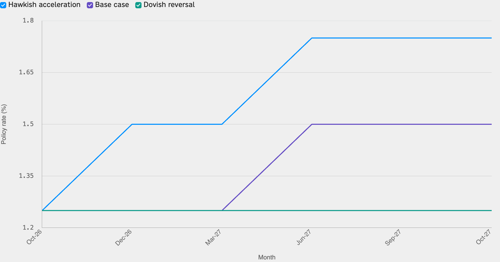
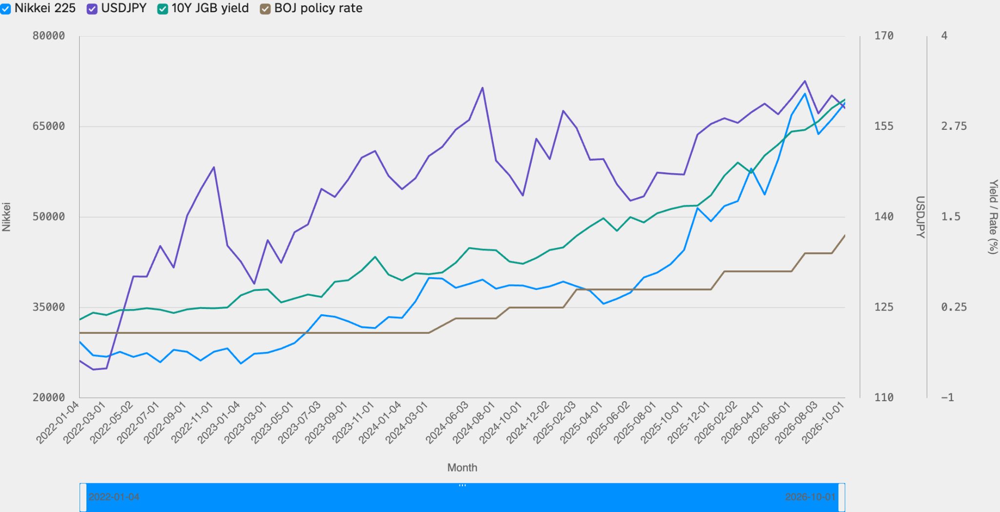

<!--
id: RX-USECASE-0076
type: use-case
language: zh-tw
locale: zh-TW
author: Reflexivity Research
kb_imported: 2026-10-17
status: draft
translation_status: localized_from_en_canonical
original_language: en
source_type: reflexivity-platform-demo
source_manifest: RX-USECASE-0076
prompt_status: present
prompt_basis: localized_from_en_verbatim
-->

# 建立日本銀行政策利率情境與日本資產敏感度

[← 依資產類別瀏覽](../README.md) · [全部使用案例](../../README.md)

**適用使用者：** 總體、固定收益與多資產投資經理  
**資產類別：** 總體、債券、外匯、股票  
**研究觀察期間：** 2026年9月至10月政策及市場環境

> 圖表與數值反映指定時期的研究示例，不代表即時市場報價或投資建議。

**[在Reflexivity開啟研究示例（英文）→](https://app.reflexivity.com/alfred?mode=research&conversationId=94da7a6f-1577-4177-887e-eee11c61c381&scrollTo=top)**

## 使用的提示詞

> [!IMPORTANT]
> 請為未來12個月建立日本銀行政策利率的三種情境：鷹派加速（薪資及通膨維持高檔，6個月內兩次各升息25個基點）、基準情境（再升息25個基點後，視春鬥及核心通膨暫停）與鴿派轉向（景氣不振或日圓升值引發輸入型通縮，因而長期維持利率）。請量化各情境對日經指數、USD/JPY及10年期JGB殖利率的方向及區間，參照歷史升息與2022至2024年YCC退出過程。

## 從貨幣政策預測建立跨資產情境

預測日本銀行何時升息，不代表已經知道股票、外匯與債券部位會受到何種影響。分析同時納入日美利差、日圓套利交易、出口商獲利換算、銀行股及公債期限溢酬。

原始問題中的鷹派終點約0.75%，低於研究採用的2026年9月30日政策利率 **1.25%**。因此，研究將1.25%設為新的起點。另以2026年10月13日的日經225 **67,777.52**、USD/JPY **158.64**及10年期JGB殖利率約 **3.00%** 作為市場參考。

## 三種條件式利率路徑

*圖1：假設條件下的政策利率路徑，並非日本銀行正式預測。*

| 情境 | 政策利率 | USD/JPY假設 | 10年期JGB殖利率 |
| --- | --- | --- | --- |
| 鷹派加速 | 1.25%→1.75% | 150～158 | 3.30～3.60% |
| 基準 | 1.25%→1.50% | 152～160 | 3.00～3.25% |
| 鴿派維持 | 維持1.25% | 158～168以上 | 2.60～3.00% |

鷹派情境可能推升日圓、壓抑出口商以日圓計價的獲利，但部分金融及內需類股可能受惠。鴿派情境下日圓走弱或有助出口商換算獲利，卻也可能伴隨成長疲弱。

## 對照歷史市場

*圖2：指標採用不同縱軸及單位，不能以線條相近推論報酬率一致。*

歷史JGB殖利率上升不等於單純的日本銀行決策效果；假設中的匯率干預水準也不是官方目標。若要用於實際投資，必須更新利率、薪資、通膨與市場報價。

## 其他研究資料

若希望了解同一問題在 **LSEG Workspace等其他研究環境的重現結果**，請寄信至 **jim@reflexivity.com** 並註明文件編號 **RX-USECASE-0076**。能否另行提供仍需依資料存取權及再散布授權判定。

---

[← 依資產類別瀏覽](../README.md) · [全部使用案例](../../README.md)
