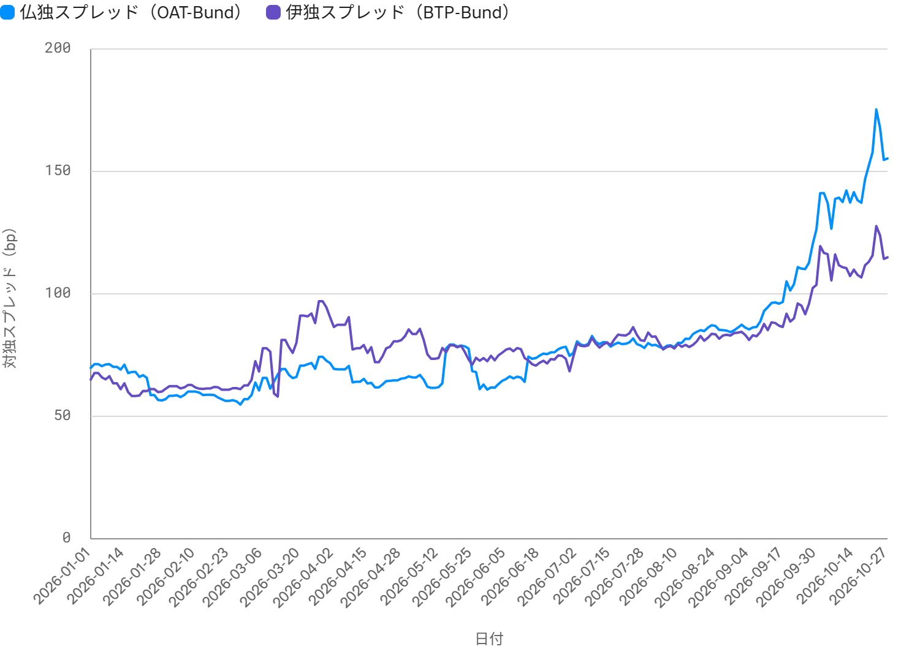

<!--
id: RX-USECASE-0110
type: use-case
language: zh-tw
locale: zh-tw
author: Reflexivity GTM Team
provider: 株式会社QUICK
source_created: 2026-10-28
published: 2026-11-17
revised: 2026-11-17
editorial_reviewed: 2026-11-17
resource: QUICK Reflexivity usage example: Compare Fed, ECB and BOJ policy stances and bond-market risks
status: published
translation_status: current
publication_mode: faithful-source-preserving
prompt_status: present
prompt_basis: source-verbatim
-->

# 比較聯儲局、歐央行、日銀政策及債券風險

<!-- locale-switcher:start -->
**Languages:** [English](../../../../en/05-use-cases/03-asset-class/03-macro/compare-fed-ecb-and-boj-policy-stances-and-bond-market-risks.md) · [日本語](../../../../ja/05-ユースケース/03-運用資産別/03-マクロ/FRB・ECB・日銀の政策姿勢と国債リスクを比較する.md) · [한국어](../../../../ko/05-유스케이스/03-운용자산별/03-매크로/연준·ECB·일본은행-정책-방향과-국채-리스크-비교.md) · [简体中文](../../../../zh-cn/05-使用案例/03-按资产类别/03-宏观/比较美联储-欧央行-日银政策及债券风险.md) · **繁體中文（臺灣）** · [繁體中文（香港）](../../../../zh-hk/05-使用案例/03-按資產類別/03-宏觀/比較聯儲局-歐央行-日銀政策及債券風險.md)
<!-- locale-switcher:end -->

[← 使用案例](../../README.md)

**案例日期:** 2026-10-28  
**主要使用功能:** Alfred

並列比較三大央行的利率、通脹風險，再延伸到法國主權債信貸風險。

> [!NOTE]
> 數字、預測及介面只反映案例所述日期的研究狀態，並非即時市場資料。

## 使用的提示詞

> [!IMPORTANT]
> FRB、ECB、BOJのそれぞれの金融スタンスと、利上げや利下げの可能性をどのように考えているかをまとめてください。

示範使用日語提問。以上保留原始措辭，以避免遺漏條件和時間範圍。

## 研究目的與操作流程

1. 並列比較三大央行的利率、通脹風險，再延伸到法國主權債信貸風險。
2. 不要只看摘要，還應核對相關企業、主題、事件及市場資料。
3. 形成當前投資結論前，確認觀察區間、指標定義及其他可能原因。

## 案例呈現的分析結果

並列比較三大央行的利率、通脹風險，再延伸到法國主權債信貸風險。

10 月 28 日比較分別採用聯儲局目標區間、歐央行存款利率及日銀隔夜利率，再延伸至法債風險。

## 產品畫面與分析圖表

## 閱讀時的注意事項

數字、預測及介面只反映案例所述日期的研究狀態，並非即時市場資料。

## 相關產品功能

- [Alfred](https://github.com/reflexivity-kb/platform/blob/main/zh-tw/03-%E7%94%A2%E5%93%81/Alfred.md)

查看連結的產品手冊可能需要存取權限。

---

本案例由 QUICK 提供。市場數字及情景判斷僅代表當時的分析。

[← 使用案例](../../README.md)
