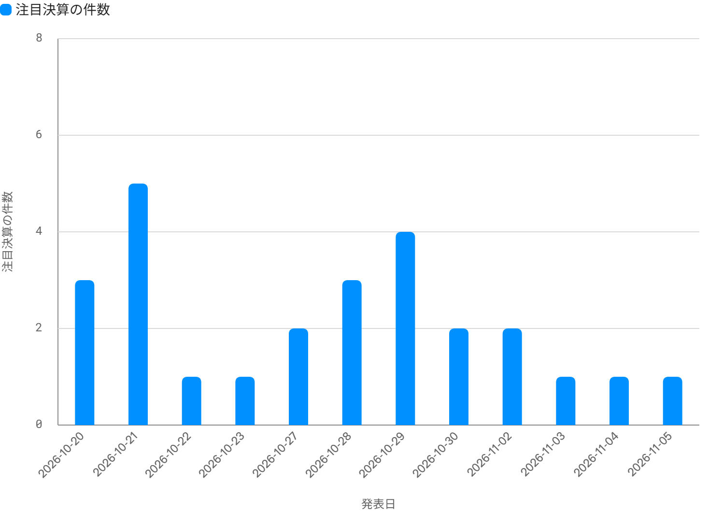

<!--
id: RX-USECASE-0109
type: use-case
language: zh-tw
locale: zh-tw
author: Reflexivity GTM Team
provider: 株式会社QUICK
source_created: 2026-10-15
published: 2026-11-17
revised: 2026-11-17
editorial_reviewed: 2026-11-17
resource: QUICK Reflexivity usage example: Build a dated earnings watchlist for US reporting season
status: published
translation_status: current
publication_mode: faithful-source-preserving
prompt_status: present
prompt_basis: source-verbatim
-->

# 按公布日期整理美國業績季關注企業

<!-- locale-switcher:start -->
**Languages:** [English](../../../../en/05-use-cases/03-asset-class/04-equities/build-a-dated-earnings-watchlist-for-us-reporting-season.md) · [日本語](../../../../ja/05-ユースケース/03-運用資産別/04-株式/米国決算シーズンの注目銘柄を発表日順に整理する.md) · [한국어](../../../../ko/05-유스케이스/03-운용자산별/04-주식/미국-실적-시즌-관심-기업을-날짜별로-정리.md) · [简体中文](../../../../zh-cn/05-使用案例/03-按资产类别/04-股票/按发布日期整理美国财报季关注公司.md) · **繁體中文（臺灣）** · [繁體中文（香港）](../../../../zh-hk/05-使用案例/03-按資產類別/04-股票/按公布日期整理美國業績季關注企業.md)
<!-- locale-switcher:end -->

[← 使用案例](../../README.md)

**案例日期:** 2026-10-15  
**主要使用功能:** Alfred, Events

篩選十至十一月業績季的重要公司，按日期排列並解釋關注理由。

> [!NOTE]
> 數字、預測及介面只反映案例所述日期的研究狀態，並非即時市場資料。

## 使用的提示詞

> [!IMPORTANT]
> 10月20日から11月6日にかけて多くの企業の決算発表があります。 マーケットの動向をモニターするために、注目すべき企業の決算発表について発表日順にリストアップしてください。注目すべき理由についても記載してください。

示範使用日語提問。以上保留原始措辭，以避免遺漏條件和時間範圍。

## 研究目的與操作流程

1. 篩選十至十一月業績季的重要公司，按日期排列並解釋關注理由。
2. 不要只看摘要，還應核對相關企業、主題、事件及市場資料。
3. 形成當前投資結論前，確認觀察區間、指標定義及其他可能原因。

## 案例呈現的分析結果

篩選十至十一月業績季的重要公司，按日期排列並解釋關注理由。

研究從 10 月 20 日至 11 月 6 日約 1,260 間企業業績中精選 26 間重要公司。

## 產品畫面與分析圖表

## 閱讀時的注意事項

數字、預測及介面只反映案例所述日期的研究狀態，並非即時市場資料。

## 相關產品功能

- [Alfred](https://github.com/reflexivity-kb/platform/blob/main/zh-tw/03-%E7%94%A2%E5%93%81/Alfred.md)
- [Events](https://github.com/reflexivity-kb/platform/blob/main/zh-tw/03-%E7%94%A2%E5%93%81/%E4%BA%8B%E4%BB%B6%E6%97%A5%E6%9B%86.md)

查看連結的產品手冊可能需要存取權限。

---

本案例由 QUICK 提供。市場數字及情景判斷僅代表當時的分析。

[← 使用案例](../../README.md)
