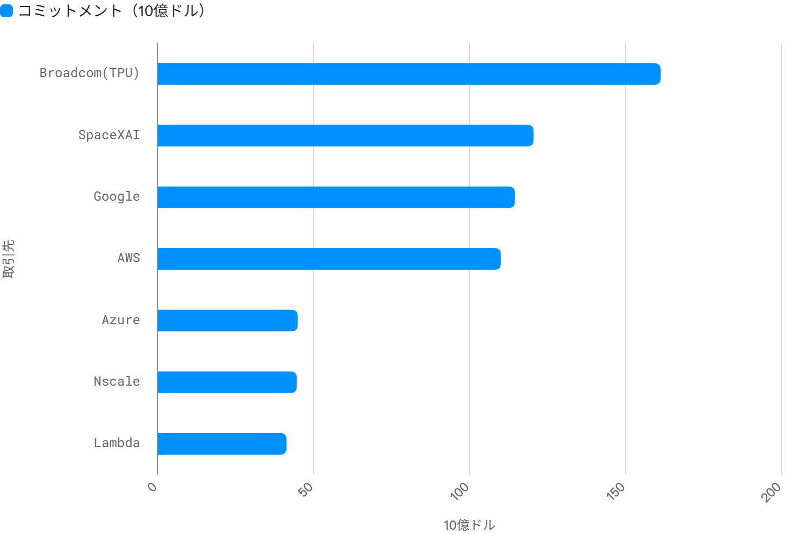

<!--
id: RX-USECASE-0102
type: use-case
language: zh-tw
locale: zh-tw
author: Reflexivity GTM Team
provider: 株式会社QUICK
source_created: 2026-10-30
published: 2026-11-17
revised: 2026-11-17
editorial_reviewed: 2026-11-17
resource: QUICK Reflexivity usage example: Map circular financing among AI investors and compute suppliers
status: published
translation_status: current
publication_mode: faithful-source-preserving
prompt_status: present
prompt_basis: source-verbatim
-->

# 梳理 AI 投資者與算力供應商的循環融資

<!-- locale-switcher:start -->
**Languages:** [English](../../../../en/05-use-cases/03-asset-class/04-equities/map-circular-financing-among-ai-investors-and-compute-suppliers.md) · [日本語](../../../../ja/05-ユースケース/03-運用資産別/04-株式/AI投資家と計算資源供給者の循環型資金関係を可視化する.md) · [한국어](../../../../ko/05-유스케이스/03-운용자산별/04-주식/AI-투자자와-컴퓨트-공급사의-순환-금융-구조-분석.md) · [简体中文](../../../../zh-cn/05-使用案例/03-按资产类别/04-股票/梳理-AI-投资者与算力供应商的循环融资.md) · **繁體中文（臺灣）** · [繁體中文（香港）](../../../../zh-hk/05-使用案例/03-按資產類別/04-股票/梳理-AI-投資者與算力供應商的循環融資.md)
<!-- locale-switcher:end -->

[← 使用案例](../../README.md)

**案例日期:** 2026-10-30  
**主要使用功能:** Alfred, Knowledge Graph

利用 Anthropic S-1 連接股權投資和雲端、晶片供應關係，區分確定承諾與估算。

> [!NOTE]
> 數字、預測及介面只反映案例所述日期的研究狀態，並非即時市場資料。

## 使用的提示詞

> [!IMPORTANT]
> NVIDIA、Anthoropic、Meta、Google、Amazon、Microsoftなど取引先の増資や債券を引き受ける契約が多く発生しています。これらAI関連企業の出資とビジネスの関係性をわかりやすく表にしてください。Anthoropicの発行したS-1の内容も参考にして回答してください。

示範使用日語提問。以上保留原始措辭，以避免遺漏條件和時間範圍。

## 研究目的與操作流程

1. 利用 Anthropic S-1 連接股權投資和雲端、晶片供應關係，區分確定承諾與估算。
2. 不要只看摘要，還應核對相關企業、主題、事件及市場資料。
3. 形成當前投資結論前，確認觀察區間、指標定義及其他可能原因。

## 案例呈現的分析結果

利用 Anthropic S-1 連接股權投資和雲端、晶片供應關係，區分確定承諾與估算。

研究把約 4,170 億美元確定運算付款責任與 1,250–1,500 億美元後續訂單分開。

- [相關官方披露](https://www.sec.gov/Archives/edgar/data/2130357/000162828026067168/anthropicpbc-sx1.htm)

## 產品畫面與分析圖表

## 閱讀時的注意事項

數字、預測及介面只反映案例所述日期的研究狀態，並非即時市場資料。

## 相關產品功能

- [Alfred](https://github.com/reflexivity-kb/platform/blob/main/zh-tw/03-%E7%94%A2%E5%93%81/Alfred.md)
- [Knowledge Graph](https://github.com/reflexivity-kb/platform/blob/main/zh-tw/03-%E7%94%A2%E5%93%81/%E7%9F%A5%E8%AD%98%E5%9C%96%E8%AD%9C.md)

查看連結的產品手冊可能需要存取權限。

---

本案例由 QUICK 提供。市場數字及情景判斷僅代表當時的分析。

[← 使用案例](../../README.md)
