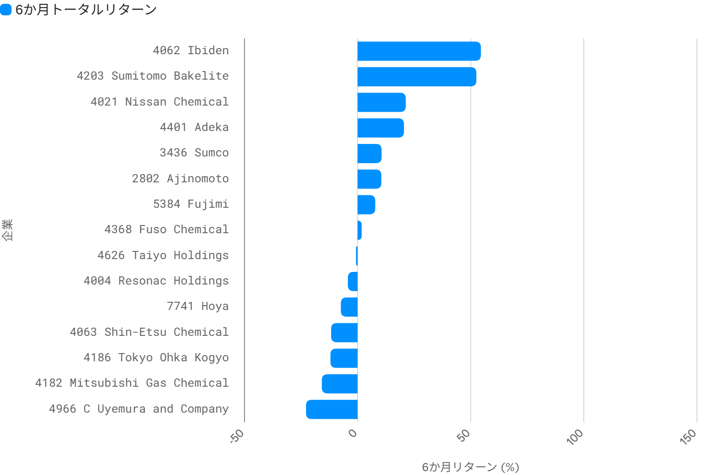

<!--
id: RX-USECASE-0101
type: use-case
language: zh-tw
locale: zh-tw
author: Reflexivity GTM Team
provider: 株式会社QUICK
source_created: 2026-10-23
published: 2026-11-17
revised: 2026-11-17
editorial_reviewed: 2026-11-17
resource: QUICK Reflexivity usage example: Compare Japanese stocks inside the semiconductor materials theme
status: published
translation_status: current
publication_mode: faithful-source-preserving
prompt_status: present
prompt_basis: source-verbatim
-->

# 比較半導體材料主題中的日本企業表現

<!-- locale-switcher:start -->
**Languages:** [English](../../../../en/05-use-cases/03-asset-class/04-equities/compare-japanese-stocks-inside-the-semiconductor-materials-theme.md) · [日本語](../../../../ja/05-ユースケース/03-運用資産別/04-株式/半導体材料テーマの日本企業を騰落別に分析する.md) · [한국어](../../../../ko/05-유스케이스/03-운용자산별/04-주식/반도체-소재-테마의-일본-기업-성과-비교.md) · [简体中文](../../../../zh-cn/05-使用案例/03-按资产类别/04-股票/比较半导体材料主题中的日本公司表现.md) · **繁體中文（臺灣）** · [繁體中文（香港）](../../../../zh-hk/05-使用案例/03-按資產類別/04-股票/比較半導體材料主題中的日本企業表現.md)
<!-- locale-switcher:end -->

[← 使用案例](../../README.md)

**案例日期:** 2026-10-23  
**主要使用功能:** Themes, Knowledge Graph, Alfred

擷取半導體材料主題下的日本企業，比較六個月回報及公司層面的推動因素。

> [!NOTE]
> 數字、預測及介面只反映案例所述日期的研究狀態，並非即時市場資料。

## 使用的提示詞

> [!IMPORTANT]
> 業界テーマ「半導体材料」に含まれている日本企業で、過去6か月間のパフォーマンスを分析し、高パフォーマンスの企業と、低パフォーマンスの企業の背景について説明してください。

示範使用日語提問。以上保留原始措辭，以避免遺漏條件和時間範圍。

## 研究目的與操作流程

1. 擷取半導體材料主題下的日本企業，比較六個月回報及公司層面的推動因素。
2. 不要只看摘要，還應核對相關企業、主題、事件及市場資料。
3. 形成當前投資結論前，確認觀察區間、指標定義及其他可能原因。

## 案例呈現的分析結果

擷取半導體材料主題下的日本企業，比較六個月回報及公司層面的推動因素。

半導體材料主題的 15 間日本企業中，揖斐電 +54.5%、住友電木 +52.5% 等表現領先。

## 產品畫面與分析圖表

## 閱讀時的注意事項

數字、預測及介面只反映案例所述日期的研究狀態，並非即時市場資料。

## 相關產品功能

- [Themes](https://github.com/reflexivity-kb/platform/blob/main/zh-tw/03-%E7%94%A2%E5%93%81/%E6%8A%95%E8%B3%87%E4%B8%BB%E9%A1%8C.md)
- [Knowledge Graph](https://github.com/reflexivity-kb/platform/blob/main/zh-tw/03-%E7%94%A2%E5%93%81/%E7%9F%A5%E8%AD%98%E5%9C%96%E8%AD%9C.md)
- [Alfred](https://github.com/reflexivity-kb/platform/blob/main/zh-tw/03-%E7%94%A2%E5%93%81/Alfred.md)

查看連結的產品手冊可能需要存取權限。

---

本案例由 QUICK 提供。市場數字及情景判斷僅代表當時的分析。

[← 使用案例](../../README.md)
