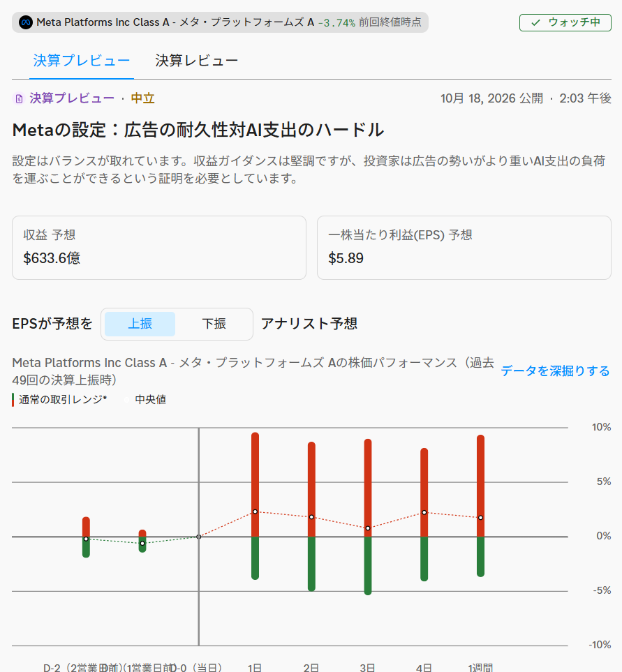

<!--
id: RX-USECASE-0107
type: use-case
language: zh-tw
locale: zh-tw
author: Reflexivity GTM Team
provider: 株式会社QUICK
source_created: 2026-10-20
published: 2026-11-17
revised: 2026-11-17
editorial_reviewed: 2026-11-17
resource: QUICK Reflexivity usage example: Use Events and Asset Overview to prepare for earnings season
status: published
translation_status: current
publication_mode: faithful-source-preserving
prompt_status: not_provided
prompt_basis: not_provided
-->

# 用事件日曆與個股概覽準備美國業績季

<!-- locale-switcher:start -->
**Languages:** [English](../../../../en/05-use-cases/03-asset-class/04-equities/use-events-and-asset-overview-to-prepare-for-earnings-season.md) · [日本語](../../../../ja/05-ユースケース/03-運用資産別/04-株式/Eventsと銘柄概要で米国決算シーズンを準備する.md) · [한국어](../../../../ko/05-유스케이스/03-운용자산별/04-주식/Events와-종목-개요로-미국-실적-시즌-준비.md) · [简体中文](../../../../zh-cn/05-使用案例/03-按资产类别/04-股票/用事件日历与个股概览准备美国财报季.md) · **繁體中文（臺灣）** · [繁體中文（香港）](../../../../zh-hk/05-使用案例/03-按資產類別/04-股票/用事件日曆與個股概覽準備美國業績季.md)
<!-- locale-switcher:end -->

[← 使用案例](../../README.md)

**案例日期:** 2026-10-20  
**主要使用功能:** Events, Asset Overview, Insights

於個股概覽查看單家公司業績日期，利用事件日曆瀏覽整體日程及預覽、回顧。

> [!NOTE]
> 數字、預測及介面只反映案例所述日期的研究狀態，並非即時市場資料。

## 使用的提示詞

提供資料中未載明實際使用的提示詞全文。

## 研究目的與操作流程

1. 於個股概覽查看單家公司業績日期，利用事件日曆瀏覽整體日程及預覽、回顧。
2. 不要只看摘要，還應核對相關企業、主題、事件及市場資料。
3. 形成當前投資結論前，確認觀察區間、指標定義及其他可能原因。

## 案例呈現的分析結果

於個股概覽查看單家公司業績日期，利用事件日曆瀏覽整體日程及預覽、回顧。

個股概覽顯示日本時間業績日期，事件日曆展示總日程，預覽與回顧分別對應公布前後。

## 產品畫面與分析圖表

## 閱讀時的注意事項

數字、預測及介面只反映案例所述日期的研究狀態，並非即時市場資料。

## 相關產品功能

- [Events](https://github.com/reflexivity-kb/platform/blob/main/zh-tw/03-%E7%94%A2%E5%93%81/%E4%BA%8B%E4%BB%B6%E6%97%A5%E6%9B%86.md)
- [Asset Overview](https://github.com/reflexivity-kb/platform/blob/main/zh-tw/03-%E7%94%A2%E5%93%81/%E5%80%8B%E8%82%A1%E7%B8%BD%E8%A6%BD.md)
- [Insights](https://github.com/reflexivity-kb/platform/blob/main/zh-tw/03-%E7%94%A2%E5%93%81/%E7%A0%94%E7%A9%B6%E6%B4%9E%E5%AF%9F.md)

查看連結的產品手冊可能需要存取權限。

---

本案例由 QUICK 提供。市場數字及情景判斷僅代表當時的分析。

[← 使用案例](../../README.md)
