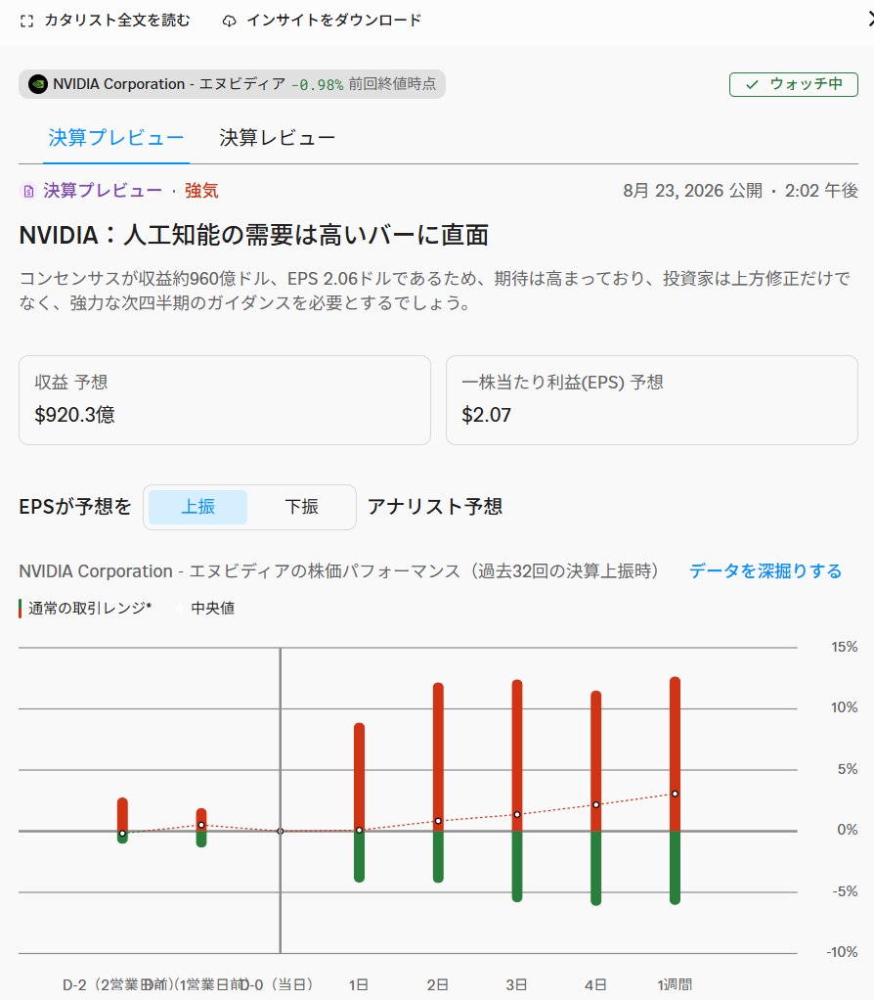

<!--
id: RX-USECASE-0084
type: use-case
language: zh-tw
locale: zh-tw
author: Reflexivity GTM Team
provider: 株式会社QUICK
source_created: 2026-08-25
published: 2026-11-17
revised: 2026-11-17
editorial_reviewed: 2026-11-17
resource: QUICK Reflexivity usage example: Prepare for NVIDIA earnings with Preview and Review
status: published
translation_status: current
publication_mode: faithful-source-preserving
prompt_status: not_provided
prompt_basis: not_provided
-->

# 運用業績預覽與回顧研究 NVIDIA 財報

<!-- locale-switcher:start -->
**Languages:** [English](../../../../en/05-use-cases/03-asset-class/04-equities/prepare-for-nvidia-earnings-with-preview-and-review.md) · [日本語](../../../../ja/05-ユースケース/03-運用資産別/04-株式/NVIDIA決算をプレビューとレビューで追う.md) · [한국어](../../../../ko/05-유스케이스/03-운용자산별/04-주식/NVIDIA-실적-발표-전후-프리뷰와-리뷰-활용.md) · [简体中文](../../../../zh-cn/05-使用案例/03-按资产类别/04-股票/通过业绩预览与回顾研究-NVIDIA-财报.md) · **繁體中文（臺灣）** · [繁體中文（香港）](../../../../zh-hk/05-使用案例/03-按資產類別/04-股票/運用業績預覽與回顧研究-NVIDIA-財報.md)
<!-- locale-switcher:end -->

[← 使用案例](../../README.md)

**案例日期:** 2026-08-25  
**主要使用功能:** Events, Insights, Asset Overview

於事件日曆查看營收、每股盈利預期與關鍵指標，公布後再與業績回顧對照。

> [!NOTE]
> 數字、預測及介面只反映案例所述日期的研究狀態，並非即時市場資料。

## 使用的提示詞

提供資料中未載明實際使用的提示詞全文。

## 研究目的與操作流程

1. 於事件日曆查看營收、每股盈利預期與關鍵指標，公布後再與業績回顧對照。
2. 不要只看摘要，還應核對相關企業、主題、事件及市場資料。
3. 形成當前投資結論前，確認觀察區間、指標定義及其他可能原因。

## 案例呈現的分析結果

於事件日曆查看營收、每股盈利預期與關鍵指標，公布後再與業績回顧對照。

示例依次展示業績日曆、收入及 EPS 預期、關鍵指標與公布後的回顧。

## 產品畫面與分析圖表

## 閱讀時的注意事項

數字、預測及介面只反映案例所述日期的研究狀態，並非即時市場資料。

## 相關產品功能

- [Events](https://github.com/reflexivity-kb/platform/blob/main/zh-tw/03-%E7%94%A2%E5%93%81/%E4%BA%8B%E4%BB%B6%E6%97%A5%E6%9B%86.md)
- [Insights](https://github.com/reflexivity-kb/platform/blob/main/zh-tw/03-%E7%94%A2%E5%93%81/%E7%A0%94%E7%A9%B6%E6%B4%9E%E5%AF%9F.md)
- [Asset Overview](https://github.com/reflexivity-kb/platform/blob/main/zh-tw/03-%E7%94%A2%E5%93%81/%E5%80%8B%E8%82%A1%E7%B8%BD%E8%A6%BD.md)

查看連結的產品手冊可能需要存取權限。

---

本案例由 QUICK 提供。市場數字及情景判斷僅代表當時的分析。

[← 使用案例](../../README.md)
