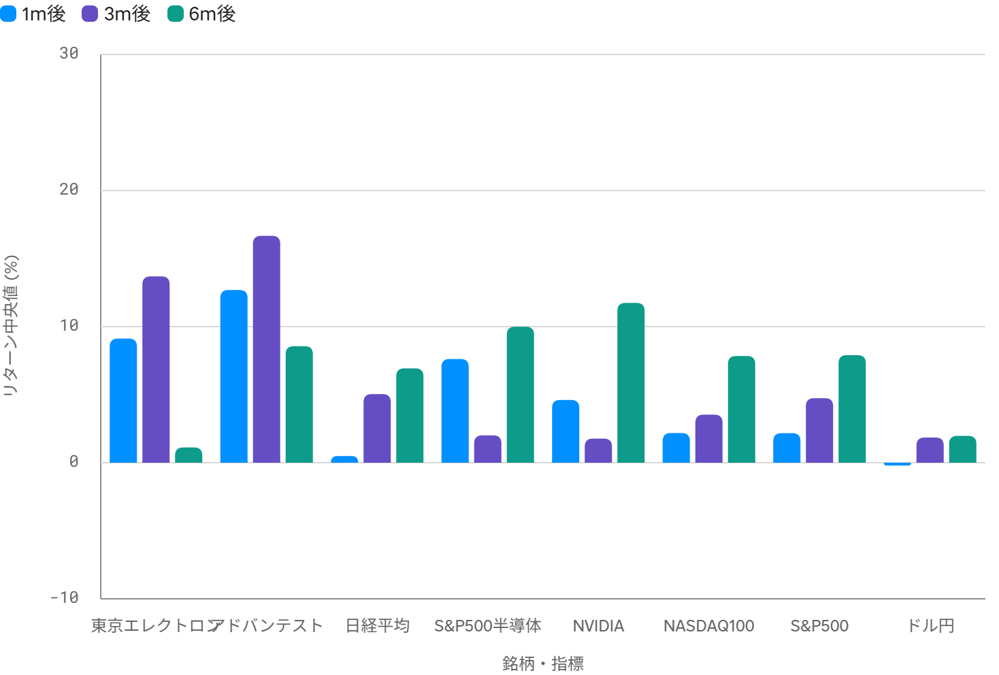

<!--
id: RX-USECASE-0106
type: use-case
language: zh-tw
locale: zh-tw
author: Reflexivity GTM Team
provider: 株式会社QUICK
source_created: 2026-11-05
published: 2026-11-17
revised: 2026-11-17
editorial_reviewed: 2026-11-17
resource: QUICK Reflexivity usage example: Explain different US and Japan equity reactions to midterm results
status: published
translation_status: current
publication_mode: faithful-source-preserving
prompt_status: present
prompt_basis: source-verbatim
-->

# 解釋美國中期選舉後美日股市反應分化

<!-- locale-switcher:start -->
**Languages:** [English](../../../../en/05-use-cases/03-asset-class/05-multi-asset/explain-different-us-and-japan-equity-reactions-to-midterm-results.md) · [日本語](../../../../ja/05-ユースケース/03-運用資産別/05-マルチアセット/米中間選挙後の米株と日本株の反応差を分析する.md) · [한국어](../../../../ko/05-유스케이스/03-운용자산별/05-멀티에셋/미국-중간선거-후-미국·일본-주가-반응-차이-분석.md) · [简体中文](../../../../zh-cn/05-使用案例/03-按资产类别/05-多资产/解释美国中期选举后美日股市反应分化.md) · **繁體中文（臺灣）** · [繁體中文（香港）](../../../../zh-hk/05-使用案例/03-按資產類別/05-多資產/解釋美國中期選舉後美日股市反應分化.md)
<!-- locale-switcher:end -->

[← 使用案例](../../README.md)

**案例日期:** 2026-11-05  
**主要使用功能:** Alfred

比較美國指數上升與日本 AI、半導體股下跌，並區分政策、監管及美元日圓情景。

> [!NOTE]
> 數字、預測及介面只反映案例所述日期的研究狀態，並非即時市場資料。

## 使用的提示詞

> [!IMPORTANT]
> 米国中間選挙の結果、民主党が大勝しました。この結果、日本の株式市場ではAI関連株や半導体関連株が下落しました。一方で米国ではS&P500もNASDAQ指数も上昇しました。今後のAI関連株や半導体関連株について市場の見通しはどうなるのかシナリオを示してください。また、ドル円の為替レートの見通しも合わせてシナリオを提示して下さい。

示範使用日語提問。以上保留原始措辭，以避免遺漏條件和時間範圍。

## 研究目的與操作流程

1. 比較美國指數上升與日本 AI、半導體股下跌，並區分政策、監管及美元日圓情景。
2. 不要只看摘要，還應核對相關企業、主題、事件及市場資料。
3. 形成當前投資結論前，確認觀察區間、指標定義及其他可能原因。

## 案例呈現的分析結果

比較美國指數上升與日本 AI、半導體股下跌，並區分政策、監管及美元日圓情景。

11 月 5 日美日 AI 股份與大市指數走勢分化，研究提出基準、樂觀和悲觀三種情景。

## 產品畫面與分析圖表

## 閱讀時的注意事項

數字、預測及介面只反映案例所述日期的研究狀態，並非即時市場資料。

## 相關產品功能

- [Alfred](https://github.com/reflexivity-kb/platform/blob/main/zh-tw/03-%E7%94%A2%E5%93%81/Alfred.md)

查看連結的產品手冊可能需要存取權限。

---

本案例由 QUICK 提供。市場數字及情景判斷僅代表當時的分析。

[← 使用案例](../../README.md)
